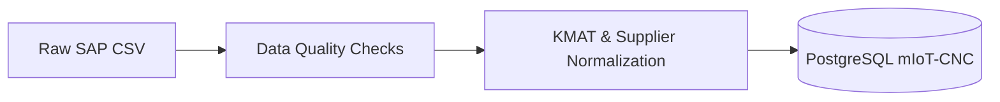

# mIoT CNC Dispatch Logs Migration & Data Cleaning

Data cleaning, validation, and migration pipeline for processing SAP CNC machine dispatch logs into the **mIoT-CNC** PostgreSQL data warehouse.

---

## 🚀 Workflow Overview



1. **Pre-processing:** Clean and sanitize raw SAP extract (`event_log_master_sap_*.csv`).
2. **Data Quality (DQ) Quarantine:** Filter corrupt, missing, or duplicate records into audit CSV files.
3. **Master Data Mapping:** Standardize machine models against `KMAT.csv` and normalize supplier codes (`ACE` ➔ `MCD`, `AMS` ➔ `TCD`).
4. **Database Ingestion:** Load clean data into `bronze.raw_machine_dispatch_logs`, sync dimensions (`sap.dim_product`, `sap.dim_branch`), and trigger machine activation via `miot_support.activate_cnc_id()`.

---

## 🛡️ Data Quality (DQ) Checks

Invalid records are segregated into audit CSVs during execution:

| File | Filter / Condition |
| :--- | :--- |
| `01_dq_cancelled_machines.csv` | Orders flagged as cancelled (`CancelIndicator == 'X'`) |
| `02_dq_duplicated_cnc.csv` | Duplicate `CNCID` entries in incoming batch |
| `03_dq_null_cnc.csv` | Records with missing/null `CNCID` |
| `04_dq_invalid_cncid_pattern.csv` | `CNCID` not matching pattern `^[^-]{8}(?:-[^-]{8}){3}$` |
| `04b_dq_already_present_cncid.csv` | `CNCID` already exists in `sap.fact_machine_dispatch_logs` |
| `05_dq_out_of_kmat_cnc.csv` | Machine models unmapped against `KMAT.csv` catalog |

---

## 📁 Repository Structure

```text
├── final.ipynb           # Main pipeline notebook (DQ checks, ETL, and DB load)
├── bronze_cleanup.ipynb  # Bronze layer staging notebook
├── load.ipynb            # Database loader & activation script
├── KMAT.csv              # Material master catalog lookup
├── .env.example          # Environment variables template
└── <date>_cleanups/      # Output folders containing DQ quarantined records
```

---

## ⚙️ Quick Start

### 1. Installation

```bash
# Setup virtual environment
python -m venv .venv
.venv\Scripts\Activate.ps1    # On Linux/macOS: source .venv/bin/activate

# Install dependencies
pip install pandas psycopg2-binary sshtunnel python-dotenv numpy
```

### 2. Configuration

Copy and update the `.env` file:

```bash
cp .env.example .env
```

Configure your SSH bastion host (`SSH_HOST`, `SSH_USERNAME`, `SSH_PASSWORD`) and PostgreSQL credentials (`DB_HOST`, `DB_NAME`, `DB_USER`, `DB_PASSWORD`).

### 3. Run Pipeline

1. Place the new SAP dispatch CSV in the project root.
2. Open **`final.ipynb`** in Jupyter.
3. Update the input filename in the read cell and run all cells.
4. Quarantined records will be saved in the cleanup directory, and clean records will be migrated to PostgreSQL.

---

## 👤 Author

- **Yaswanth S** ([@yaswanth-amit](https://github.com/yaswanth-amit)) - Ace Micromatic Group / AMIT
